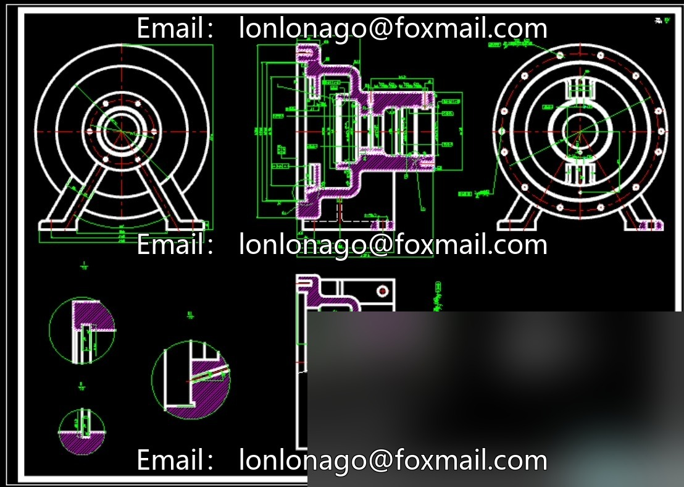
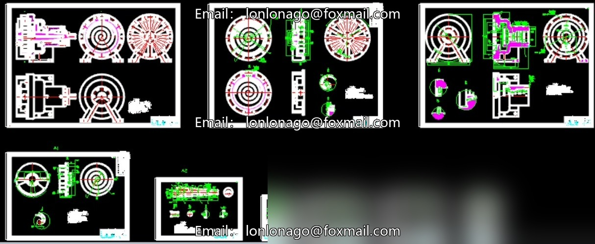

# Cold water unit design; cold water unit design diagram; cold water unit design CAD diagram

## Body

Cold water unit design; cold water unit design diagram; cold water unit design CAD diagram
This document contains a design specification and CAD drawings (condenser + evaporator).
The manual mainly introduces how to determine the main design parameters. The important part is the design calculation of the dry evaporator and shell and tube type condenser. Elucidating how to determine the refrigerant flow rate and the cold-material flow rate Heat transfer tube count Thermal conductivity. Additionally, Completed the cooling water flow resistance calculation. Design and calculation of the overall structure. 523

The material covers cold water unit design, design drawings and CAD diagrams, including design instructions for condenser and evaporator, with calculations for refrigerant flow, coolant flow, heat transfer tube count and heat transfer coefficient, as well as cooling water flow resistance and overall structural design calculation.

<!-- AI_ENRICHED -->

## Images

## Payment

Here is a pay link on Stripe ( https://buy.stripe.com/3cs8yP7sY87d0vu9AB ). Please contact me lonlonago@foxmail.com after funding $89, and I will send you a complete data files , thank you!

